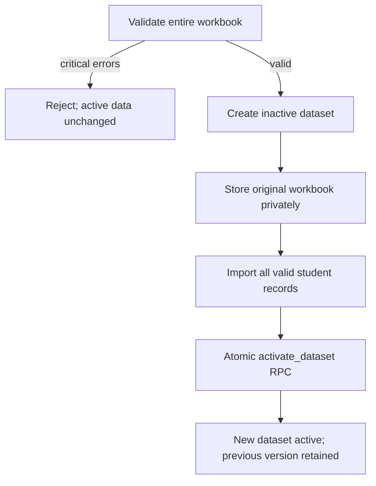

# PPRI / PIRI Placement Readiness Dashboard

A production-ready, private, mobile-first Next.js dashboard for placement officers, management, faculty and trainers. It reads revised `PPRI` Excel workbooks, validates every record, versions each upload in Supabase, and refreshes every KPI, chart, comparison and student report without a code change or Vercel redeployment.

## Multiple colleges

The application now supports one platform administrator and separate college viewers, Excel datasets, settings, histories and reports. Follow [MULTI_COLLEGE_SETUP.md](MULTI_COLLEGE_SETUP.md) before deploying this version. Existing installations must apply the new migration; new installations must apply both migrations in order. Future colleges and usernames are added in Supabase, without editing source code.

## What is included

- Overview with eight KPIs, grade/package distributions, branch/section rankings, aptitude-versus-coding scatter, top performers, support priorities, and strongest/weakest competencies.
- Competency analysis for all four groups and all sixteen 1–5 competencies, including branch/section heatmaps and gaps from 5.
- Branch and section comparison with conditional tables, rankings, grade/package mix, best group and priority-support group.
- Student Explorer with global filters, UID/name search, sorting, pagination, Top N, phone cards, desktop table and CSV export.
- Individual one-page A4 student report with print and browser “Save as PDF” support.
- Data-quality view with calculation mismatches, source mapping, missing/duplicate checks and methodology.
- Admin upload preview, progress, critical validation gate, persistent original file storage, version activation and rollback.
- Admin-editable institute title, logo URL, colours, PIRI weights, grade thresholds, support threshold, pagination and footer.
- Demo mode with 40 fully synthetic students and assessments; it works immediately without Supabase and contains no real student data.
- Supabase Authentication, PostgreSQL, Storage, Row-Level Security and server-side session validation.

## Technology

Next.js 16 App Router, React 19, TypeScript, Tailwind CSS 4, Recharts, Lucide React, ExcelJS, Zod, Supabase JS, `@supabase/ssr`, Vitest and Vercel.

## Run locally

Requirements: Node.js 22.13 or newer and npm.

```bash
npm install
npm run auth:setup
npm run dev
```

Open `http://localhost:3000`. Without Supabase the bundled 40-record synthetic demo dataset loads automatically. All identities, scores, remarks, and reviews are fictional. Dashboard viewing is open, but Admin & settings and PDF download controls require a signed-in dashboard account. Persistent upload/settings remain disabled until Supabase is connected.

The setup command creates a unique password for ID `admin`, saves its salted hash and a session secret to `.env.local`, and puts the password in `.env.admin-credentials.local`. Both files are gitignored and must remain private. Save the password in a password manager; the website never reads the plaintext credential file. Do not put either file in `public/` or share them with a code archive.

To choose a different ID on first setup: `npm run auth:setup -- college.admin`. To deliberately replace credentials and invalidate all existing admin access sessions: `npm run auth:setup -- college.admin --rotate`, then restart/redeploy. The command preserves unrelated Supabase environment values.

## Enable Supabase

1. For a new database, run `supabase/migrations/202608120001_ppri_dashboard.sql`, then `supabase/migrations/202610150001_college_workspaces.sql` in Supabase SQL Editor. Existing databases run only the new migration.
2. Run `npm run auth:setup` if no access configuration exists, then add the Supabase variables from `.env.example` to `.env.local`. Preserve the generated `ACCESS_SESSION_SECRET`.
3. Keep exactly one platform administrator in `public.profiles` with role `admin` and no college assignment. Add colleges and assign viewers as described in [MULTI_COLLEGE_SETUP.md](MULTI_COLLEGE_SETUP.md).
4. Restart `npm run dev`, sign in, open **Admin & settings**, and upload an `.xlsx` workbook.

For click-by-click instructions, read [BEGINNER_DEPLOYMENT_GUIDE.md](BEGINNER_DEPLOYMENT_GUIDE.md).

## Environment variables

| Variable | Exposure | Purpose |
| --- | --- | --- |
| `NEXT_PUBLIC_SUPABASE_URL` | Browser-safe | Supabase project URL |
| `NEXT_PUBLIC_SUPABASE_PUBLISHABLE_KEY` | Browser-safe | RLS-protected browser/server client |
| `SUPABASE_SERVICE_ROLE_KEY` | Server only | Secure imports, private storage and atomic dataset activation |
| `NEXT_PUBLIC_SITE_URL` | Browser-safe | Production site URL |
| `ACCESS_SESSION_SECRET` | Server only | Required random secret of at least 32 characters for 30-minute administrator sessions |
| `ACCESS_ADMIN_ID` | Server only | Local/demo administrator ID; ignored in Supabase mode |
| `ACCESS_ADMIN_PASSWORD_HASH` | Server only | Salted scrypt hash generated by `auth:setup`; ignored in Supabase mode |

Never put the service-role/secret key in a variable beginning with `NEXT_PUBLIC_`. Never commit `.env.local`.

## Required Excel format

- Worksheet: `PPRI`
- Row 1: report title
- Row 2: group headings
- Actual headers detected automatically (currently Row 3)
- Records start immediately below the detected header
- `UID` is unique
- Blank rows are ignored
- Only `.xlsx` is accepted; maximum upload size is 4 MB (kept below common serverless request limits)

The importer cleans spacing, maps the three repeated `TOTAL HR SCORE` columns by their Excel position, validates 1–5 competencies and 0–100 aptitude/coding, recalculates Total PIRI/PIRI/grade without overwriting source values, and blocks activation for critical data errors. See [DATA_DICTIONARY.md](DATA_DICTIONARY.md).

## Safe dataset activation



If parsing, storage or record insertion fails, the old active dataset is untouched. Only the final database function changes the active version, serializing activation within the selected college. Each college has its own active version.

## Commands

```bash
npm run lint       # ESLint
npm run typecheck  # strict TypeScript
npm run test       # Vitest automated suite
npm run build      # Vercel-compatible production build
npm run start      # run the production build
```

`npm run demo:synthetic` reproducibly regenerates the public-safe `data/demo-data.json` from formulas in `scripts/generate-synthetic-demo.ts`, without reading a workbook. Its 40 fictional students cover CSE, CIVIL, IT, and MECH.

`npm run demo:generate -- /absolute/path/workbook.xlsx` copies records from a source workbook into `data/demo-data.json`. This developer utility is intended for private use only: never commit or publicly deploy its output if the workbook contains real student data. Restore the synthetic dataset with `npm run demo:synthetic` before publishing. Normal administrators upload through the authenticated website.

## Security model

- Demo dashboard viewing contains fully synthetic sample records and is open; do not replace them with real student data in a public deployment or repository. Admin pages and official PDF downloads still require the configured local administrator login. Missing configuration fails closed.
- With Supabase configured, `/dashboard` is private and requires a valid server-verified session.
- `viewer` can view only their assigned college and download its college/branch PDFs. Admin & settings remain administrator-only. The existing Student Explorer CSV export is unchanged.
- The single platform `admin` manages all colleges and must verify their password for a short administrator session to upload datasets, restore versions and change settings. Supabase mode only accepts Supabase accounts, never the local/demo credentials.
- Administrator access uses signed, expiring HttpOnly, SameSite cookies (Secure in production). The 30-minute session is bound to the verified account; its admin role is checked again on every protected request. Sign out clears access in this browser. Changing the signing secret invalidates all protected sessions; changing the local ID/hash invalidates local sessions.
- Pages and APIs enforce access on the server, including direct PDF requests. Login/logout, admin writes and PDF generation reject missing or foreign request origins. Post-login destinations are restricted to internal dashboard routes. PDF and auth API responses are not cached.
- Login attempts are limited per account and per running server. This in-memory limiter resets on restart and is not shared across serverless instances; use deployment-level rate limiting/WAF (and Supabase Auth protections) for a public production rollout.
- Access controls cannot prevent screenshots, copying, or a browser's own Print / Save as PDF command for data a user can already view. Student-profile Print/PDF buttons use the data already available to the signed-in user; college/branch PDFs are generated only by the protected server endpoint. This is app authorization, not a second authentication factor for existing direct Supabase access.
- RLS protects every public table. The original workbook bucket is private and admin-only.
- The service-role key is imported only by server-only modules and never enters browser bundles.
- Filenames, MIME type, extension and size are validated. Workbook content is validated before activation.

## Deployment

The project uses standard `next build`, includes `package-lock.json`, and requires no custom Vercel build configuration. Import the GitHub repository into Vercel, add the Supabase variables and a unique `ACCESS_SESSION_SECRET` as server secrets, and deploy over HTTPS. If intentionally deploying a sample-only demo, add the generated `ACCESS_ADMIN_ID` and `ACCESS_ADMIN_PASSWORD_HASH` too. In the hosting UI use the raw hash with `$` separators, not the `.env` backslash escapes. Never upload the plaintext credential file. Real student data requires Supabase/private dashboard mode.
# PDF handover reports

On **College Placement Overview**, select **Download PDF** and sign in with your college account if prompted. After signing in, the report dialog opens automatically. Choose **Overall college** for all branches, or **Individual branch** and a branch such as IT, then choose **Download PDF report**. Files download directly and can be printed or shared. Expired sessions require another login.

Reports include an executive readiness summary, package potential, branch comparisons (or section comparisons within a branch), 16 competency scores, training priorities, report dates, and dataset context. They use the full active dataset for the selected scope; dashboard filters do not apply. A branch report contains only that branch's aggregates. No individual names or UIDs are exported. Demo datasets are labelled on every page, and package bands are explicitly described as estimates.

The PDF is generated by the existing Next.js server, after verifying signed-in dashboard access, using only the server's active dataset. No external PDF service is used. Update the institution name in Admin & settings before generating handover reports (requires an administrator). The normal project install/build commands include the PDF dependency.
